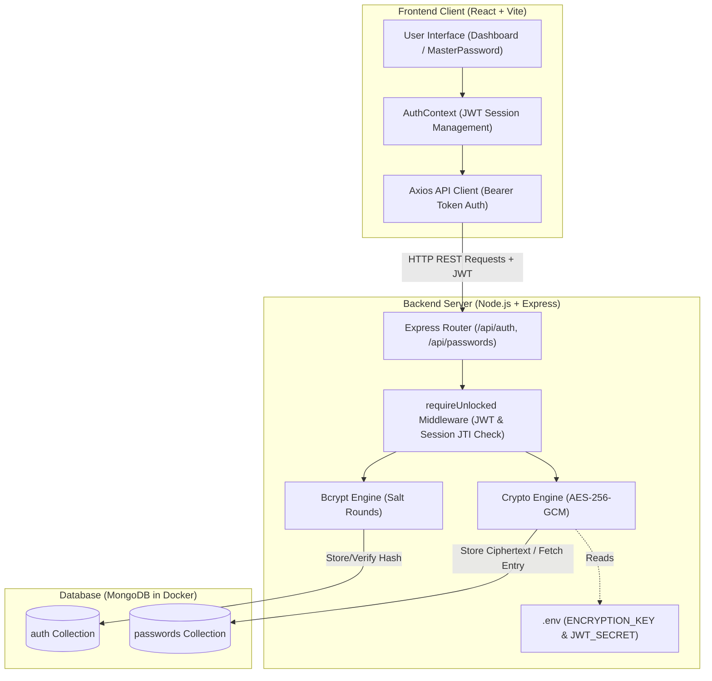
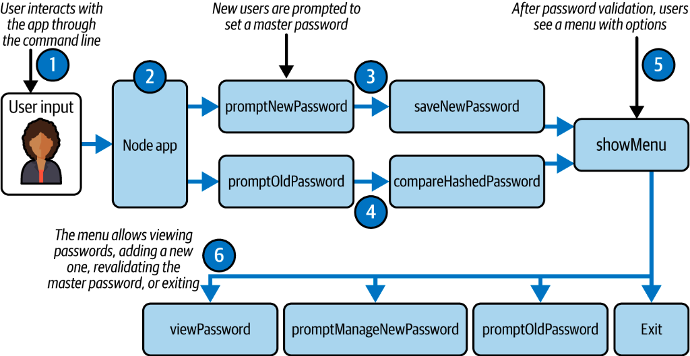
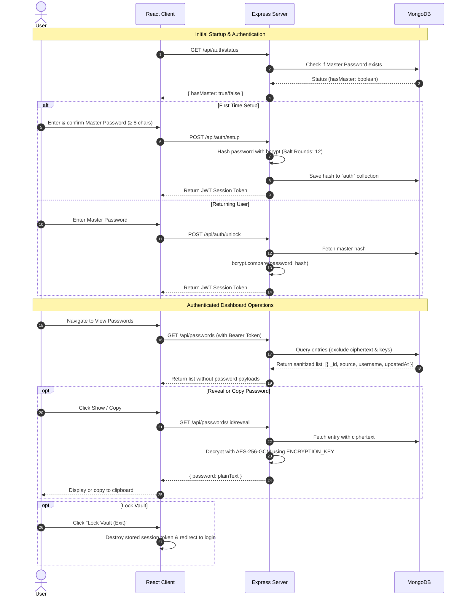

# 🔐 VaultKeeper — Secure Password Manager

A full-stack MERN password management system built with robust security standards. VaultKeeper provides authenticated access, master password protection, and authenticated cryptographic storage for application credentials.

---

## 📌 Table of Contents
- [Overview](#-overview)
- [Key Features](#-key-features)
- [Architecture & System Flow](#-architecture--system-flow)
  - [Frontend to Backend Architecture](#frontend-to-backend-architecture)
  - [Application Workflow & User Flow](#application-workflow--user-flow)
- [Cryptographic Design: Hashing vs Encryption](#-cryptographic-design-hashing-vs-encryption)
- [Tech Stack](#-tech-stack)
- [Project Structure](#-project-structure)
- [Getting Started](#-getting-started)
  - [Prerequisites](#prerequisites)
  - [1. Database Setup with Docker](#1-database-setup-with-docker)
  - [2. Backend Setup](#2-backend-setup)
  - [3. Frontend Setup](#3-frontend-setup)
- [API Reference](#-api-reference)
- [Database Collections](#-database-collections)
- [Security Highlights](#-security-highlights)

---

## 📖 Overview

**VaultKeeper** is an enterprise-grade password management solution engineered to solve common credential storage vulnerabilities. It features a modern **React (Vite)** single-page application and an **Express / Node.js** API backed by **MongoDB**. 

VaultKeeper enforces a single-session master vault policy: master passwords are never stored in plaintext or reversible formats, and sensitive credentials remain encrypted at rest using industry-standard **AES-256-GCM** authenticated encryption.

---

## ✨ Key Features

- **Master Vault Authentication**: Single master password gates all vault access with configurable bcrypt hashing and unique cryptographic session tokens (`jti`).
- **End-to-End Cryptographic Security**: Saved credentials are encrypted using **AES-256-GCM** with a distinct Initialization Vector (IV) and authentication tag per entry.
- **Zero-Exposure Credential Listing**: Database queries deliberately project out password fields; decrypted values are fetched strictly on-demand when explicitly requested by the user.
- **Credential Management (CRUD)**:
  - Add new credentials with duplicate source protection.
  - Search, view, edit, and delete stored accounts.
  - In-memory credential copy and reveal toggles.
- **Session Re-verification & Invalidation**: Ability to re-validate master credentials inside the dashboard, with auto-invalidation on subsequent logins.
- **Dockerized Environment**: Ready-to-run containerized MongoDB configuration for rapid local deployment and consistent environments.

---

## 📐 Architecture & System Flow

### Frontend to Backend Architecture

The client communicates with the backend over REST endpoints secured via JSON Web Tokens (JWT). Decryption keys reside exclusively on the server, ensuring that a client compromise does not leak the global encryption secret.



---

### Application Workflow & User Flow

The high-level user flow from startup to managing vault credentials:



#### Detailed Interactive Flow:



---

## 🛡️ Cryptographic Design: Hashing vs Encryption

| Purpose | Technique | Implementation | Why this method? |
| :--- | :--- | :--- | :--- |
| **Master Password** | **One-way Hashing** | `bcrypt` (Salt rounds: 12) | VaultKeeper only needs to verify correctness (`bcrypt.compare`). The original password is never needed. Hashing is irreversible; even if database records are exposed, rainbow tables and brute-force attacks are strongly mitigated. |
| **Saved Passwords** | **Two-way Authenticated Encryption** | `AES-256-GCM` with random IV per record | Users must retrieve the original plaintext password to authenticate with services. Irreversible hashing cannot be used here. Authenticated encryption (GCM) guarantees both confidentiality and tamper detection. |
| **Master Key Isolation** | **Environment Isolation** | `server/.env` | The master encryption key is kept strictly outside the database and git repositories, ensuring a database snapshot alone cannot decrypt saved credentials. |

---

## 🛠️ Tech Stack

- **Frontend**: [React 18](https://react.dev/), [Vite](https://vitejs.dev/), [React Router v6](https://reactrouter.com/), [Axios](https://axios-http.com/)
- **Backend**: [Node.js](https://nodejs.org/), [Express](https://expressjs.com/)
- **Security**: [bcrypt](https://github.com/kelektiv/node.bcrypt.js), [jsonwebtoken (JWT)](https://github.com/auth0/node-jsonwebtoken), Native Node.js `crypto` (`aes-256-gcm`)
- **Database & DevOps**: [MongoDB 7.0](https://www.mongodb.com/), [Mongoose](https://mongoosejs.com/), [Docker & Docker Compose](https://www.docker.com/)

---

## 📂 Project Structure

```
vaultkeeper/
├── client/                     # Frontend Single Page Application
│   ├── src/
│   │   ├── components/         # Reusable views (SavedPasswords, AddUpdatePassword, etc.)
│   │   ├── context/            # AuthContext & session state management
│   │   ├── pages/              # MasterPassword and Dashboard pages
│   │   ├── api.js              # Centralized Axios client & route calls
│   │   ├── App.jsx             # Route definitions & guards
│   │   └── index.css           # Styling
│   ├── package.json
│   └── vite.config.js
│
├── server/                     # Backend REST API
│   ├── config/                 # Database connection (Mongoose)
│   ├── middleware/             # Route authorization middleware
│   ├── models/                 # Mongoose schemas (Auth, Password)
│   ├── mongosh/                # Standalone database shell demo scripts
│   ├── routes/                 # API controllers (auth.js, passwords.js)
│   ├── utils/                  # Cryptography helpers & session management
│   ├── seed.js                 # Database seeder script
│   ├── server.js               # Application entry point
│   ├── .env.example            # Environment variable template
│   └── package.json
│
├── docker-compose.yml          # Container configuration for MongoDB
├── workflow.png                # Architecture & user flow diagram
└── README.md                   # Project documentation
```

---

## 🚀 Getting Started

### Prerequisites

- **Node.js** (v18+ recommended)
- **npm** (v9+)
- **Docker Desktop** (for containerized MongoDB)

---

### 1. Database Setup with Docker

Start the MongoDB database container:

```bash
docker compose up -d
```

*(Alternatively, run manually:)*
```bash
docker run -d --name vaultkeeper-mongo -p 27017:27017 mongo:7
```

To verify the database or inspect records via Mongo shell:
```bash
docker exec -it vaultkeeper-mongo mongosh
```

---

### 2. Backend Setup

1. Navigate to the server folder and install dependencies:
   ```bash
   cd server
   npm install
   ```

2. Initialize your environment configuration:
   ```bash
   cp .env.example .env
   ```

3. Generate a secure 32-byte (64 hex characters) encryption key:
   ```bash
   npm run genkey
   ```
   Copy the generated key into `ENCRYPTION_KEY` in `server/.env`.

4. Configure your `server/.env`:
   ```env
   PORT=5000
   MONGO_URI=mongodb://localhost:27017/passwordManagerDB
   ENCRYPTION_KEY=<your-64-character-hex-key>
   JWT_SECRET=super_secret_jwt_key_replace_in_production
   CLIENT_ORIGIN=http://localhost:5173
   SALT_ROUNDS=12
   ```

5. Run the backend server:
   ```bash
   npm run dev
   ```
   The backend API will start on `http://localhost:5000`.

*(Optional)* Seed sample encrypted credentials:
```bash
npm run seed
```

---

### 3. Frontend Setup

1. Open a new terminal and navigate to the client folder:
   ```bash
   cd client
   npm install
   ```

2. Start the Vite development server:
   ```bash
   npm run dev
   ```
   Open `http://localhost:5173` in your browser.

---

## 📡 API Reference

### Authentication Endpoints (`/api/auth`)

| Method | Endpoint | Auth | Description |
| :--- | :--- | :---: | :--- |
| `GET` | `/status` | No | Check if a master password has been configured. |
| `POST` | `/setup` | No | Initialize the master password (first time setup). |
| `POST` | `/unlock` | No | Validate master password and receive a JWT session token. |
| `POST` | `/verify` | Bearer Token | Re-validate the master password from within the dashboard. |

### Password Vault Endpoints (`/api/passwords`)

| Method | Endpoint | Auth | Description |
| :--- | :--- | :---: | :--- |
| `GET` | `/` | Bearer Token | List all credentials (passwords excluded from query). |
| `GET` | `/:id/reveal` | Bearer Token | Decrypt and reveal a specific credential by ID. |
| `POST` | `/` | Bearer Token | Store a new credential (or update existing by source). |
| `PUT` | `/:id` | Bearer Token | Update an existing credential by ID. |
| `DELETE` | `/:id` | Bearer Token | Remove a credential from the vault. |

---

## 🗄️ Database Collections

The application uses **passwordManagerDB** in MongoDB with two collections:

1. **`auth`**:
   ```json
   {
     "type": "auth",
     "hash": "$2b$12$e8YJ...",
     "saltRounds": 12
   }
   ```
2. **`passwords`**:
   ```json
   {
     "source": "GitHub",
     "sourceKey": "github",
     "username": "developer@example.com",
     "password": "iv_hex:authTag_hex:ciphertext_hex",
     "createdAt": "2026-10-11T00:00:00.000Z",
     "updatedAt": "2026-10-11T00:00:00.000Z"
   }
   ```

---

## 🔒 Security Highlights

- **Field Level Security**: Default queries use Mongoose projection (`{ password: 0, sourceKey: 0 }`) ensuring ciphertext is not transmitted over the wire when fetching lists.
- **Single Active Session Token (`jti`)**: Logging into the vault immediately invalidates previous tokens by refreshing the registered session identifier.
- **Tamper Protection**: GCM mode utilizes an authentication tag (`tagHex`) to verify that encrypted payloads have not been modified or corrupted.
- **Master Password Zero-Knowledge Server Storage**: The server never stores, logs, or returns the plaintext master password.
